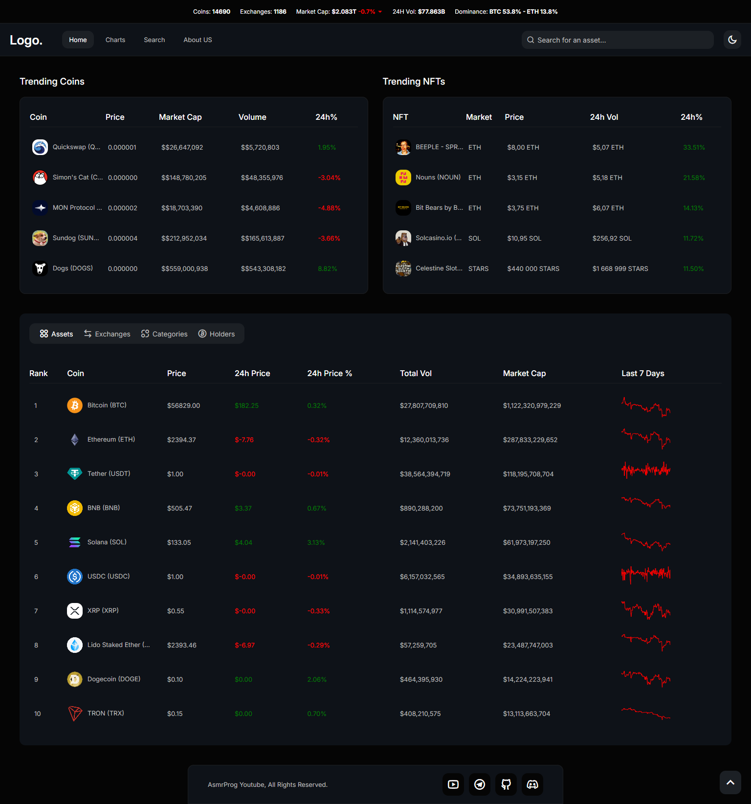
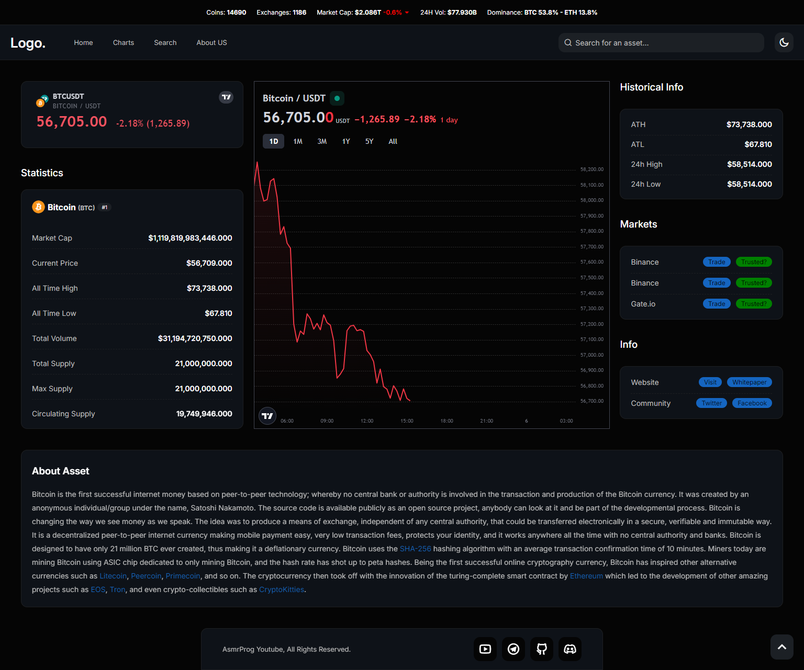
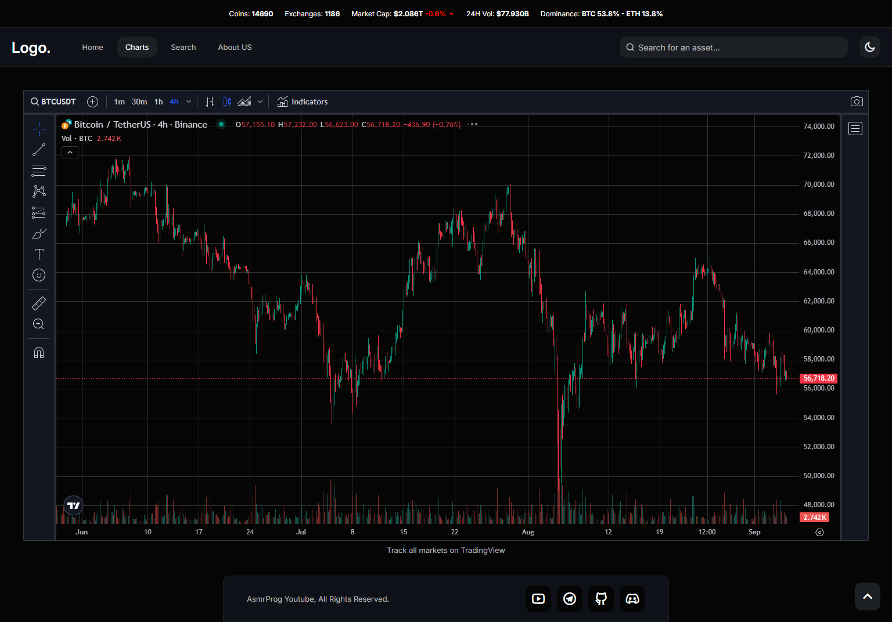
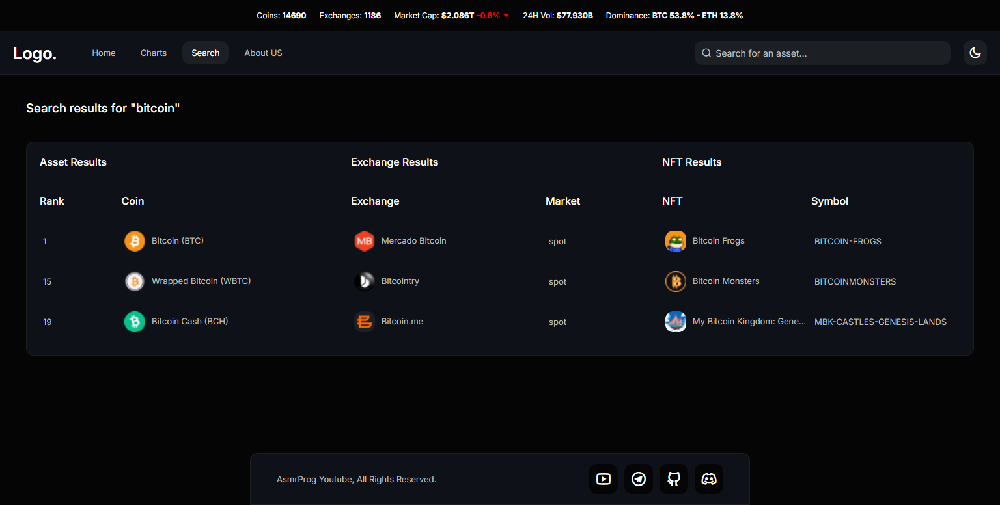
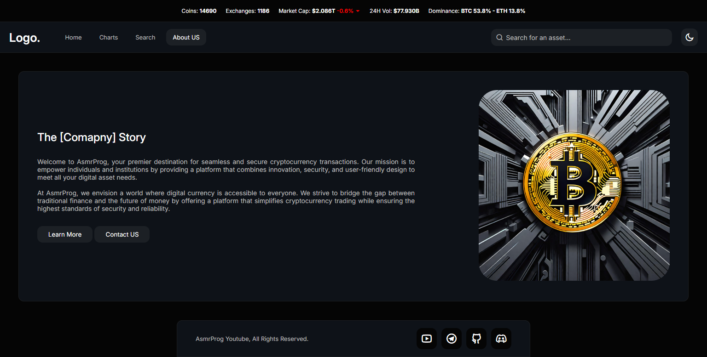
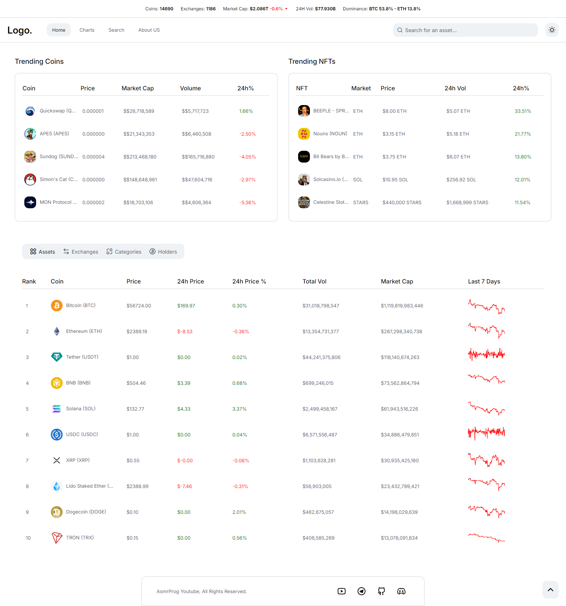
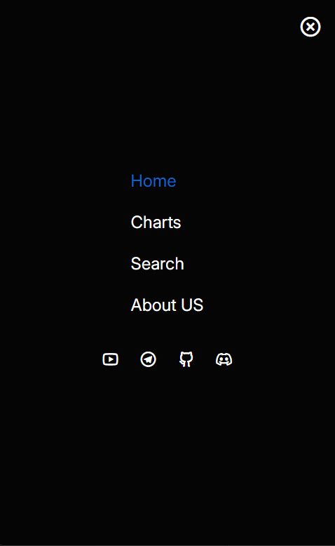

# CryptoSphere 🌐🚀
### Real-Time Cryptocurrency Marketplace & Analytics Platform

**CryptoSphere** is a modern, high-performance cryptocurrency intelligence and marketplace platform engineered by **Vennu Manikanta Pavan**. Built from the ground up, the platform features real-time cryptocurrency data streaming, dynamic market dominance tracking, TradingView charting integration, and an ultra-smooth macOS-inspired magnetic physics Dock navigation bar.

---

## 👨‍💻 Developer Information

- **Developer:** Vennu Manikanta Pavan
- **Degree:** B.Tech – CSE (Artificial Intelligence & Machine Learning)
- **Institution:** CMR Institute of Technology, Hyderabad (2022 – Present)
- **Location:** Hyderabad, India
- **GitHub:** [https://github.com/Pavan-19190401](https://github.com/Pavan-19190401)
- **LinkedIn:** [https://linkedin.com/in/manikanta-pavan-vennu1906](https://linkedin.com/in/manikanta-pavan-vennu1906)
- **Email:** [manikantapavanv@gmail.com](mailto:manikantapavanv@gmail.com)
- **Phone:** [+91 7396870319](tel:+917396870319)

---

## ✨ Key Features

- **macOS Magnetic Dock Navbar:** Interactive navigation bar built with raised-cosine falloff curves, integral neighbour displacement, spring pointer tracking, floating tooltips, and click bounce animations.
- **Live Market Data:** Real-time cryptocurrency prices, global volume, market cap change percentages, and BTC/ETH dominance via CoinGecko API.
- **Interactive TradingView Charts:** Professional-grade technical charting widgets with live candles, volume, and indicators.
- **Trending Assets & NFTs:** Top trending coins and non-fungible tokens updated with rank change indicators.
- **Exchanges & Bitcoin Treasuries:** Detailed explorer for top global exchanges and corporate entities holding Bitcoin treasuries.
- **Deep Search Engine:** Instant unified search for coins, exchanges, and NFTs with fast query routing.
- **Adaptive Dark / Light Themes:** Smooth theme toggling with persistent user preference storage.
- **Fully Responsive Architecture:** Clean cross-platform layouts for desktop, tablet, and mobile with animated drawer menu.

---

## 🛠️ Tech Stack & Competencies

- **Frontend:** Vanilla JavaScript (ES6+), HTML5, CSS3 (Custom Variables, Flexbox, Grid, Keyframe Animations)
- **Interactive UI Physics:** Custom macOS Dock Physics Engine (Cosine Falloff & Integral Stretching)
- **APIs & Libraries:** CoinGecko REST API, TradingView Technical Widgets, Remix Icon System, Chart.js
- **Tooling:** Git, GitHub, VS Code

---

## 📸 Screenshots

### Main Dashboard

### Coin Analytics & Statistics

### Live TradingView Charts

### Unified Search

### About Developer & Platform

### Light & Dark Theme Support

### Mobile Drawer Menu

---

## 📄 License & Attribution

Designed and engineered with passion by **Vennu Manikanta Pavan** © 2024–2026 CryptoSphere. All rights reserved.